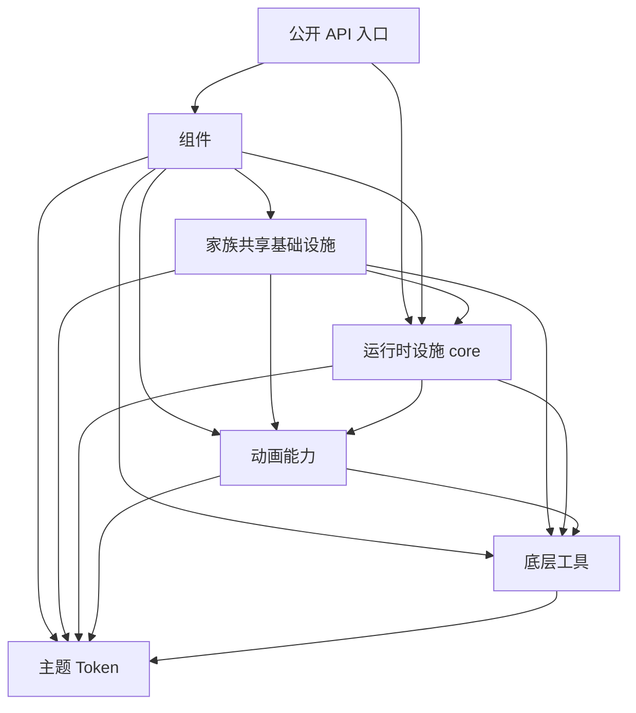

# HeroSideUI 架构整理与演进规则

## 目的与状态

HeroSideUI 的整理目标是让新增组件持续遵循同一套职责划分、依赖方向和接入规则，使同类能力的修改集中在明确的拥有者中，并保持公开 API 稳定。

本文基于 0.16.1、提交 `887be09d53ed216cac57e4fe6d437afecbb1f454` 的审查，区分已观察到的结构问题与建议建立的约束。**ARCH-01 已完成公共动画及消费者迁移，并与图标能力一起落实局部边界与测试；ARCH-02 已完成家族共享能力的归属整理；ARCH-03 已完成低层依赖方向与延迟加载；ARCH-04 已完成全局字体接入契约；ARCH-05、ARCH-06 已完成代码与文档，待测试验收；其他架构项仍按各节状态追踪。**运行缺陷、验证环境、复现方法和测试范围保存在 [2026-11-06 审查验证明细](architecture-audit-2026-11-06.md)。

现有“一组件一包”、主题 Token、Provider 和公共动画可以继续作为基础。当前需要治理的核心是：公共能力已经存在，但抽取、接入和后续新增组件没有形成持续一致的规则。

## 当前结构问题

### ARCH-01 公共能力抽取与消费者迁移未形成闭环（已完成）

**状态：已完成，2026-11-06。** 公共实现、已知消费者、保留差异与验证入口一并落地，详见 [ARCH-01 公共能力与消费者迁移记录](architecture-arch-01-completion.md)。

| 原问题                                         | 当前实现与消费者                                                        |
| ---------------------------------------------- | ----------------------------------------------------------------------- |
| Checkbox 与 Listbox 仅共用绘制，描勾控制仍分散 | 两者均使用 CheckDrawAnimation，统一延迟、取消与终态，保留不同节奏       |
| 五种循环效果分别维护循环与启停                 | 共用 LoopDriver，Spinner、Skeleton、Progress、CircularProgress 一起接入 |
| Select、Autocomplete 箭头按钮重复              | 统一使用内部共享 SelectorButton，原模块只保留兼容导入                   |
| 简单过渡散落在组件内部                         | 已盘点组件使用公共值、属性或几何过渡；Calendar、Toast 保留业务编排      |
| 规则停留在文档                                 | 架构检查、公共契约和真实消费者测试已接入现有 CI                         |

返回句柄有效期、隐藏恢复和动画开关差异已明确说明。此项完成不代表历史审查中的全部行为缺陷已经解决。

**持续约束：**修改公共能力时核对全部已知消费者；新增同类效果优先使用现有入口。有理由的保留实现必须说明职责和验证入口。

### ARCH-02 实际共享能力与模块拥有者不一致（已完成）

**状态：已完成，2026-11-13。** 共享能力有了明确拥有者和稳定入口，所有已知消费者一起迁移，详见 [ARCH-02 完成记录](architecture-arch-02-completion.md)。

| 原问题                                                                                | 当前实现与消费者                                                                                 |
| ------------------------------------------------------------------------------------- | ------------------------------------------------------------------------------------------------ |
| Drawer 继承 Popover 的私有遮罩并写它的私有字段                                        | 遮罩移入 `_shared/overlays`，Popover 与 Drawer 共用，提供公开的 `settle()`                       |
| Textarea、DateInput 依赖 Input 的私有外框、清除按钮、布局与样式                       | 移入 `_shared/fields`，Input、DateInput、Textarea 一起迁移；Mixin 的宿主要求由契约测试逐宿主校验 |
| Avatar 使用 Image 的私有加载器                                                        | 移入 `_shared/images`，Image 与 Avatar 共用                                                      |
| 日期组件相互引用私有模型                                                              | 纯日期模型移入 `_shared/dates`，Calendar、DateInput、TimeInput、DatePicker 家族共用              |
| Badge 引用 Chip 私有配色，CodeEditor 引用 CodeBlock 私有字体与高亮                    | 分别移入 `_shared/colors` 与 `_shared/code`                                                      |
| 未记录：直接读写别的组件的私有字段（62 行）                                           | Popover、Listbox、Input、DateFieldState 等补充公开接口，调用方全部改用                           |
| 未记录：Select 与 Autocomplete 的高度计算逐字重复，两个 Picker 各写一份 Calendar 子类 | 前者合并到 `_shared/selection`；后者改用 `Calendar(surface="popover")`                           |

有意保留的差异（Dropdown 的高度规则、Textarea 的独立样式、Mixin 形态、同组件内部协作）与兼容说明见完成记录。

**持续约束：**同一能力只有一个拥有者。跨组件通过稳定入口组合；需要另一个组件的私有字段，说明它缺少公开接口，应在拥有者上补充。`_shared` 是内部基础设施，不扩大顶层公开 API，也不在运行时依赖组件。

### ARCH-03 目录分层尚未成为明确的依赖方向（已完成）

**状态：已完成，2026-11-13。** 低层不再依赖运行时设施，公开入口按名称延迟加载，详见 [ARCH-03 完成记录](architecture-arch-03-completion.md)。

| 原问题                                                                      | 当前实现与消费者                                                                                           |
| --------------------------------------------------------------------------- | ---------------------------------------------------------------------------------------------------------- |
| `themes/font.py` 访问时查询 `FontProvider`                                  | 主题层只保留静态常量 `DEFAULT_FONT_FAMILY`，`core` 反向引用它；旧的 `FONT_FAMILY` 已删除                   |
| `utils/icon_utils.py` 默认读取 `ThemeProvider.instance()`，可能启动全局设施 | 只读取已存在的 Provider（`ThemeProvider.peek()`），不再创建；Accordion 起始图标改为显式传色                |
| 顶层与组件导出一次导入全部组件                                              | 两个入口改为按名称延迟加载，`import hero_side_ui` 不加载任何组件，使用 `Text` 不会加载日期与 Markdown 依赖 |
| 规则停留在文档                                                              | `tests/shared` 检查低层包的依赖方向和延迟加载行为                                                          |

有意保留的差异和兼容说明见完成记录。

**持续约束：**`themes` 不依赖 `core`、`components`、`utils`；`animation`、`icons`、`utils` 不依赖 `core`、`components`（`utils/icon_utils.py` 为已记录的兼容例外）；`core` 不依赖 `components`。新增公开组件时同步更新两个入口的名称表，测试会校验一致性。

### ARCH-04 组件接入与状态更新缺少统一契约（已完成）

**状态：已完成，2026-11-13。** 范围是全局字体与全局主题的接入契约，详见 [ARCH-04 完成记录](architecture-arch-04-completion.md)。

| 原问题                                                 | 当前实现与消费者                                                                                                                                                                                                                      |
| ------------------------------------------------------ | ------------------------------------------------------------------------------------------------------------------------------------------------------------------------------------------------------------------------------------- |
| 只有 `Text` 响应全局字体变化，其他组件创建时把字体写死 | 统一契约：组件提供 `_apply_font()` 并向 `FontProvider` 登记；Button、Checkbox、Radio、Switch、Tabs、Input（含 NumberInput）、Textarea、DateInput（含 TimeInput）、InputOtp、Divider、Breadcrumbs、Slider、Pagination、Calendar 已接入 |
| 内部 `Text` 的字号、等宽字体、下划线被广播覆盖         | 改用 `Text.set_size`/`set_weight`；`Text` 保留下划线；CodeBlock 的代码区退出广播                                                                                                                                                      |
| 主题接入是否有缺口                                     | 核对后无缺口，40 个组件包直接登记，其余通过继承或内部组件                                                                                                                                                                             |
| Button 的 QSS 尺寸约束可能改变几何                     | 核实未复现：切换尺寸后与重新创建的按钮尺寸一致                                                                                                                                                                                        |

有意保留的差异（等宽字体不跟随、Calendar 星期名列宽、局部字体覆盖）见完成记录。

**持续约束：**新增依赖全局字体的组件必须提供 `_apply_font()` 并登记；内部使用 `Text` 的组件通过 `Text` 的接口设置字号字重；`tests/shared/test_font_contract.py` 新增相应用例。

### ARCH-05 对象与全局设施的所有权规则分散（待测试验收）

**状态：代码与文档已完成，待维护者本地测试通过后标记完成。** 详见 [ARCH-05 完成记录](architecture-arch-05-completion.md)。

| 原问题                                                  | 当前实现与消费者                                                                                                             |
| ------------------------------------------------------- | ---------------------------------------------------------------------------------------------------------------------------- |
| tween 完成后 Qt 子对象仍被持有                          | ARCH-01 已处理                                                                                                               |
| 组件销毁后仍留在主题与字体登记里，广播时错误被吞掉      | 共用 `WidgetRegistry`：已销毁的组件自动注销，真实错误告警一次                                                                |
| 全局调色板、样式表、过滤器、stderr 接管缺少统一恢复入口 | `HeroSideUIProvider.teardown()` 还原调色板、移除滚动条样式与平滑滚动、恢复 fd 2                                              |
| 调用方传入的控件，替换时谁销毁没有规则                  | 统一为“交给组件后归组件，替换时销毁”；输入类槽位、Badge、Slider 因同时接受字符串与控件，保留“摘下归还”；Alert 由叠加改为替换 |

有意保留的差异与兼容说明见完成记录。

**持续约束：**新增接受调用方控件的接口必须在文档中写明替换时销毁还是归还；新增全局设施必须同时提供撤销入口，并纳入 `teardown()`。

### ARCH-06 架构约定缺少持续执行机制（待验收）

**状态：代码与文档已完成，待维护者本地测试和 CI 通过后标记完成。** 详见 [ARCH-06 完成记录](architecture-arch-06-completion.md)。

| 原问题                                     | 当前实现                                                                    |
| ------------------------------------------ | --------------------------------------------------------------------------- |
| 前面各项加的结构检查，CI 不运行            | CI 测试矩阵新增 `shared` 组，推送即自动运行 `tests/shared`                  |
| 新增组件漏接入全局字体，没有任何东西会发现 | 测试扫描所有组件包：自己设置了字体却没有 `_apply_font()` 与登记的，直接失败 |
| 例外分散，新人不知道哪些是故意的           | `CONTRIBUTING.md` 集中列出已登记的例外与原因，对应测试里也有名单            |
| 规矩只在架构文档里，贡献者看不到           | 新增 `CONTRIBUTING.md`：6 条规矩、自动检查范围、新增组件步骤、提交信息格式  |
| 过渡用的旧入口没人移除                     | 项目处于开发期，不保留过渡，旧入口全部删除                                  |

**仍靠评审的两条：**传入控件的所有权要写进文档、新增全局设施要有撤销入口。这两条不容易自动检查，在 `CONTRIBUTING.md` 里写明，由评审把关。

**持续约束：**新增规则必须同时有执行方式（测试或评审项）；新增例外必须登记原因，并说明为什么不能按规矩走。

## 职责与依赖方向

下表是建议的职责边界，不要求立即创建所有候选目录。

| 层或模块         | 负责                                           | 边界                                                                          |
| ---------------- | ---------------------------------------------- | ----------------------------------------------------------------------------- |
| 公开 API 入口    | 对用户提供稳定导入与兼容适配                   | 不承载控件实现和初始化副作用                                                  |
| components       | 组件组装、交互状态、公开参数、专属绘制与编排   | 优先组合公共组件和已有能力；避免跨家族私有实现依赖                            |
| 家族共享基础设施 | 输入、浮层、日期等具有明确共同消费者的基础能力 | 位于 `_shared/`；列明消费者与契约，不按具体消费组件名称分支，运行时不依赖组件 |
| core             | 主题、字体、启动等运行时设施与宿主集成         | 明确应用级资源的安装、恢复和生命周期                                          |
| animation        | 值与属性补间、循环驱动、共享语义效果           | 不读取具体组件状态，不决定组件业务流程                                        |
| themes           | 通用设计值、语义配色和组件预设                 | 不启动设施、不查询 Provider；允许依赖无应用副作用的值类型                     |
| utils            | 参数明确的颜色、图形、资源等工具               | 不隐式查询 Provider 或安装全局设施；需要 Qt 应用或线程时明确前置条件          |

建议的模块依赖方向如下，表示目标边界，并非当前代码已经满足。运行时 Provider 可以通过约定接口通知组件：

组件之间可以通过公开能力组合，例如 Markdown 组合 Link、Image、Table。共享设施不反向依赖具体消费组件。兼容入口若暂时保留旧调用方式，应明确标识过渡作用，避免把反向依赖长期隐藏在底层。

## 公共能力的抽取与接入规则

### 何时评估抽取

出现第二份语义相同的实现时，应评估共享价值，并对照状态、输入、输出、生命周期和变更原因，而非只比较代码行数或视觉外观。

下列能力通常适合共享：

- 同样的值变化与抢占机制，不同消费者只提供参数或回调。
- 相同的绘制或控制语义，仅颜色、尺寸、时间等配置不同。
- 已经被多个组件依赖、且不依赖某个具体宿主私有状态的基础部件。

只有专属行为、共享后仍需大量消费组件判断，或必须传入整套组件私有状态的实现，优先留在组件内部。只有一个消费者的现有公共能力也不因此自动删除或搬回；需要结合其公开承诺和职责判断。

### 每项公共能力需要说明什么

| 内容           | 要回答的问题                               |
| -------------- | ------------------------------------------ |
| 职责与拥有者   | 它解决哪类问题，由哪个模块维护             |
| 消费者与接入点 | 哪些实现已经迁入，哪些尚未迁入及原因       |
| 输入与状态     | 接收哪些参数，哪些状态由调用者维护         |
| 生命周期       | 谁持有、如何抢占或取消、何时释放           |
| 立即终态       | 禁用动画或不需要过渡时如何完成状态与回调   |
| 边界与例外     | 哪些行为必须由组件编排，哪些情况不适用     |
| 验证入口       | 公共契约测试与至少一个真实消费者的集成验证 |

新增公共抽象应与真实消费者一起落地。只新增一个工具文件、不替代已有同类实现，不视为完成共享能力建设。确需分批迁移时，使用同一工作项维护剩余消费者和保留原因。

### 动画如何分工

| 层次     | 公共部分                                     | 组件保留部分                                                     |
| -------- | -------------------------------------------- | ---------------------------------------------------------------- |
| 基础驱动 | 插值、循环、停止、抢占、持有与释放           | 决定何时请求变化                                                 |
| 语义效果 | 对勾描出、浮动标签、按压缩放、展开等共同语义 | 提供目标、参数和必要的绘制回调                                   |
| 专属编排 | 只抽出其中确认相同的机制                     | Toast 队列与堆叠、Drawer 开合流程、Calendar 翻页等组件状态与时序 |

不要求所有效果采用同一个外部方法名。应统一底层的持有、取消与完成语义，并由语义效果提供适合消费者的接口。现有公开导出和参数需要兼容策略，不能通过一次目录调整直接删除。

## 新增或修改组件的检查清单

- [ ] 已确认相近组件和现有公共能力，新增局部实现有明确理由。
- [ ] 未新增无说明的跨家族私有依赖；共享能力有明确拥有者。
- [ ] 逻辑状态、视觉派生、几何派生和动画值的职责清楚。
- [ ] 主题、字体、局部覆盖与禁用动画按约定接入。
- [ ] QObject、定时器、动画、临时控件和事件过滤器的退出路径完整。
- [ ] 公开导入、构造参数、信号和原生 Qt 行为的兼容性变化已说明。
- [ ] 验证公共能力本身，也验证消费者的真实状态变化与生命周期。
- [ ] 更新文档和示例；修改公共能力时检查其全部已知消费者。

本清单以适用能力为准，静态控件无需实现无关动画、复杂状态机或公共基类。控件仍保留适合自身的原生 Qt 基类；优先通过组合和明确的能力接口统一规则，避免建立承载所有行为的万能 BaseWidget。

## 持续检查与例外管理

| 方式             | 检查内容                                                               | 避免的误判                                   |
| ---------------- | ---------------------------------------------------------------------- | -------------------------------------------- |
| 导入边界检查     | 新增跨家族私有引用、共享层反向引用消费者、Token 或工具层读取运行时状态 | 不将允许的组件公开组合判为错误               |
| 公共能力契约测试 | 抢占、取消、立即终态、重复调用、对象销毁和资源释放                     | 不仅检查动画内部字段是否置空                 |
| 消费者集成测试   | 主题、字体、尺寸和状态变化能否沿公共入口完整生效                       | 不以公共工具测试通过替代组件接入测试         |
| API 兼容检查     | 公开导入、参数和信号的变更                                             | 不把内部类的所有实现细节永久冻结             |
| 代码评审清单     | 新增局部机制与已有能力的语义差异、共享能力剩余迁移项                   | 不机械禁止全部 Qt 动画构造或按重复率自动抽取 |

现有依赖应作为整改基线分类，允许有理由的临时例外。例外至少记录路径、原因、替代入口和退出条件；基线不能成为永久豁免全部旧依赖的理由。

动画与图标领域的边界和契约检查已经落地，详见 ARCH-01 迁移记录。组件之间的私有依赖、共享层的依赖方向和输入类 Mixin 的宿主契约由 `tests/shared/` 执行，详见 ARCH-02 完成记录；其他架构项的检查仍需按对应整改实施。

## 分批整理与架构验收

### 第一批 建立能力清单与公共契约

以动画为试点，整理“能力、拥有者、消费者、保留差异”的对应关系，明确补间、循环、语义效果和组件编排的边界。同时修正 CI 解释器选择，保证后续验证可信。

**验收：**能够回答任意一个相关组件为何采用当前实现，以及新增同类行为应接入哪里。该清单服务实际迁移，不另建一套需要人工重复同步的大型注册系统。

### 第二批 完成动画机制与消费者迁移

先处理公共驱动的生命周期，再迁移确认同义的消费者。优先核对循环驱动、Checkbox 对勾控制，以及选择类组件的箭头部件。不同绘制方式和退场语义通过参数或组件编排保留。

**验收：**相同机制只维护一处；公共层修复能覆盖已知消费者；未迁移项有具体理由；交互和视觉节奏没有因抽取被意外改变。

### 第三批 明确家族共享能力的归属

按输入类、浮层、日期、图像加载和配色分别治理。每次只迁一个能力及其消费者，记录需要保留的组件家族约定。共享 Mixin 若继续使用，应列出宿主需要提供的状态和回调；接口若持续膨胀，应重新评估组合边界。

**验收：**修改共享部件无需追踪隐藏宿主字段或改动不相关组件；依赖拥有者与稳定入口一致。

**状态：已完成（ARCH-02，2026-11-13）。** `_shared/fields`、`_shared/overlays`、`_shared/images`、`_shared/colors`、`_shared/code`、`_shared/dates` 与 `_shared/selection` 已落地，输入类 Mixin 的宿主要求由契约测试逐宿主校验。

### 第四批 固化依赖方向和组件接入规范

统一主题与字体刷新、逻辑状态与派生状态的职责，以及全局设施安装和恢复规则。根据已决定的依赖策略处理 Token、工具、运行时与公开导出之间的边界，并加入能够持续执行的检查。

**验收：**新增组件可以遵循稳定接入点；已有特殊路径有明确去向；CI 或评审能够识别新增违规，而非依靠维护者记住全部历史。

## 图标能力的接入记录

2026-11-06，新增 `Icon` 时将公共实现与已知消费者一起接入，作为 ARCH-01 的局部实践。输入、浮层、日期等其他共享能力的归属整理由 ARCH-02 完成。

| 能力                                        | 拥有者与入口                                                    | 消费者与约束                                                                                     |
| ------------------------------------------- | --------------------------------------------------------------- | ------------------------------------------------------------------------------------------------ |
| 图标渲染、缓存、在线加载、hover 与动画      | 正式依赖 `pyside-iconify>=1.2.0,<2` 的公开 API                  | 不复制渲染器、下载器、动画驱动或请求状态机；应用可直接使用该生态                                 |
| 内置名称、外部 SVG 与 `IconData` 的统一解析 | `hero_side_ui/icons/`                                           | `Icon` 与旧 `load_svg_icon()` 共用；不引用 Provider、不接管网络策略                              |
| 离线资源                                    | 现有 `resources/icons/*.svg` 为唯一内置资源源文件               | 惰性读取、注册至保留的 `herosideui:` 前缀；不新增第二份 JSON 图标数据，也不覆盖普通 Iconify 前缀 |
| HeroUI 尺寸与语义颜色、局部主题             | `components/icon/`，尺寸放在 `themes/component_presets/icon.py` | 基于 `IconWidget` 的控件适配；不操作依赖库私有字段                                               |
| 旧静态快照 API                              | `utils/icon_utils.py` 保留兼容层，转调 `icons/`                 | 所有已通过该入口加载图标的组件同步切换后端，不逐个复制适配逻辑                                   |

旧入口的已知消费者包括 Button、ThemeSwitcher、Accordion、Input、Textarea、Autocomplete、Select、Alert、Toast、Avatar、Breadcrumbs、Calendar、NumberInput、Pagination、Listbox、Tabs、Slider、Table、Link 和 Kbd。迁移后仍保持内置名称、SVG 路径、`color="original"`、描边覆盖和缺失透明位图契约。

保留差异与后续边界：

- `load_svg_icon()` 保留 Provider 感知的默认对比色和 DPR=1 的静态尺寸契约。它是旧 API 的兼容边界；`icons/` 资源层自身不读取 Provider。新独立图标使用支持异步刷新和高 DPI 的 `Icon`。
- 旧组件字符串图标槽位仍是静态快照。远程图标需先预加载再设置；没有把它们隐式改为带请求生命周期的控件。
- Checkbox 的延迟描勾与 Switch 的轨道内图形等组件自绘语义仍由原组件持有，不在本次资源型图标迁移中改写。对勾控制与公共动画复用的后续迁移已在 ARCH-01 完成，详见迁移记录。
- HeroSideUI 不调用 `set_offline()`，不改变依赖库默认配置。内置数据已在本地，用户的其他图标仍走默认客户端；没有建立第二套全局客户端或声称两者完全隔离。

验证入口为 [资源与兼容测试](../tests/utils/test_icon_resources.py)、[Icon 消费者测试](../tests/components/test_icon.py) 和既有 [静态图标测试](../tests/utils/test_icon_utils.py)。除绘制、主题、离线与在线共存行为外，导入边界测试限制生产代码只有图标资源包与 Icon 适配包可以直接引用 `pyside_iconify`，且仅引用其公开 API。

API 与使用示例见 [Icon 文档](icon.md)。

## 架构整理的完成标准

整理完成后，应能从代码、接口与验证中直接回答以下问题：

1. 同类行为应接入哪个公共能力，哪些差异属于组件本身？
2. 某项能力由谁维护，修改它会影响哪些消费者？
3. 每份状态与资源由谁拥有，何时更新、取消或释放？
4. 一个新组件如何接入主题、字体、动画、几何和 Qt 生命周期？
5. 哪些依赖和接口需要保持稳定，新增例外如何被发现？

架构验收以这些问题是否有清晰且可执行的答案为依据。具体行为缺陷、平台支持和桌面交互质量仍按[审查验证明细](architecture-audit-2026-11-06.md)独立追踪，避免将修复若干缺陷等同于完成架构整理。
